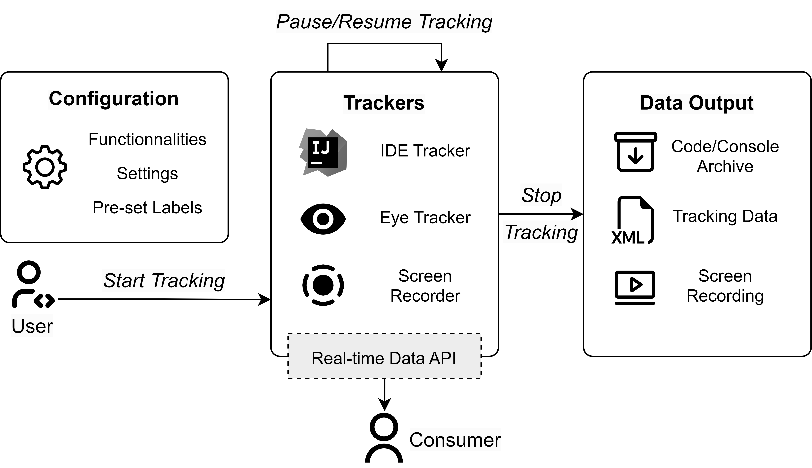

# CodeGRITS · [🌐 Visit Website](https://codegrits.github.io/CodeGRITS/) · [🚀 Install Plugin](https://plugins.jetbrains.com/plugin/28118-codegrits)

[](https://github.com/codegrits/CodeGRITS) [](https://dl.acm.org/doi/10.1145/3639478.3640037) [](https://www.youtube.com/watch?v=d-YsJfW2NMI) [](https://codegrits.github.io/CodeGRITS/docs/index.html) [](https://archive.softwareheritage.org/swh:1:dir:32d91426f07dd0f4b36ba05bc708b5a25ad06dd3) [](https://github.com/codegrits/CodeGRITS/blob/main/LICENSE)

***Enjoying CodeGRITS? Please give us a ⭐ to help more developers discover it and support future improvements!***

<p align="center">
    
</p>

[CodeGRITS](https://codegrits.github.io/CodeGRITS/) stands for **G**aze **R**ecording & **I**DE **T**racking **S**ystem. It's a plugin developed by
the [SaNDwich Lab](https://toby.li/) and is specifically designed for empirical software engineering researchers.
CodeGRITS is built on top
of [IntelliJ Platform SDK](https://plugins.jetbrains.com/docs/intellij/welcome.html), with broad compatibility with the
entire family of JetBrains IDEs and [Tobii eye-tracking devices](https://www.tobii.com/),
to track developers’ IDE interactions and eye gaze data.

The [website](https://codegrits.github.io/CodeGRITS/)'s source code is stored in the `./site` folder of this repository and deployed via GitHub Pages. The [JavaDoc](https://codegrits.github.io/CodeGRITS/docs/index.html) documentation is located in the `./site/docs` folder of this repository. They are archived together with the source code in the Software Heritage for long-term preservation.

## Key Features

- :mag: **IDE Tracking**: CodeGRITS tracks developers’ IDE interactions, including mouse clicks, keyboard inputs, etc.
- :eye: **Eye Tracking**: CodeGRITS tracks developers’ eye gaze data from [Tobii eye-tracking devices](https://www.tobii.com/), and maps them to corresponding source code elements.
- :computer: **Screen Recording**: CodeGRITS simultaneously records developers’ screen for visualizing their behaviors.
- 🔨 **Research Toolkit**: CodeGRITS provides a set of extra features for empirical SE researchers, including dynamic configuration, activity labeling, real-time data API, etc.
- 🗃️ **Data Export**: CodeGRITS exports data in XML format for further data analysis. See [Data Format](https://codegrits.github.io/CodeGRITS/data-format/) for more details.

### Cross-platform and Multilingual Support

- [x] CodeGRITS provides cross-platform support for Windows, macOS, and Linux, and is expected to be compatible with the entire family of JetBrains IDEs, including IntelliJ IDEA, PyCharm, WebStorm, etc.
- [x] CodeGRITS could extract the abstract syntax tree (AST) structure of eye gazes on multiple programming languages, as long as the IDE supports them, including Java, Python, C/C++, JavaScript, etc.

## Usage Guide

You can now [install CodeGRITS from JetBrains Marketplace](https://plugins.jetbrains.com/plugin/28118-codegrits) to use it directly in supported IDEs.

Please see the [CodeGRITS website](https://codegrits.github.io/CodeGRITS/) for more details. The Javadoc documentation is available [here](https://codegrits.github.io/CodeGRITS/docs/index.html). Please refer to the [developer guide](https://codegrits.github.io/CodeGRITS/developer/) if you want to contribute to CodeGRITS.

The data collected by CodeGRITS can be used by empirical SE researchers to understand the behaviors of developers, especially those related to eye gaze. CodeGRITS also provides a [real-time data API](https://codegrits.github.io/CodeGRITS/developer/#real-time-data-api) for future plugin developers and researchers to design context-aware programming support tools.

We provide an example project [DataStreamReceiver](https://github.com/codegrits/DataStreamReceiver) that builds on top of the real-time data API. It is designed to receive the IDE and eye tracking data and directly visualize them in two separate windows.

## Citation

The [paper](https://dl.acm.org/doi/10.1145/3639478.3640037) of CodeGRITS has been accepted by [ICSE 2024 Demonstrations Track](https://conf.researchr.org/track/icse-2024/icse-2024-demonstrations) with Artifact Available and Artifact Evaluated badges awarded. The PDF version is available [here](https://codegrits.github.io/CodeGRITS/static/paper.pdf). The [video demonstration](https://www.youtube.com/watch?v=d-YsJfW2NMI) is available on YouTube.

Please cite the following if you use CodeGRITS in your research.

```bibtex
@inproceedings{tang2024codegrits,
  title={CodeGRITS: A Research Toolkit for Developer Behavior and Eye Tracking in IDE},
  author={Tang, Ningzhi and An, Junwen and Chen, Meng and Bansal, Aakash and Huang, Yu and McMillan, Collin and Li, Toby Jia-Jun},
  booktitle={46th International Conference on Software Engineering Companion (ICSE-Companion '24)},
  year={2024},
  organization={ACM}
}
```

## Papers Using CodeGRITS

The following papers use CodeGRITS for data collection.If your work uses CodeGRITS, feel free to open a PR or contact us to be listed here.

1. **CHASE 2026** · Creative Minds at the Keyboard: Eye-Tracking Insights into How Developers Think and Code. [[ACM DL]](https://dl.acm.org/doi/10.1145/3794860.3794891)
1. **arXiv 2026** · Same Scrutiny, More Time: Eye Tracking Insights into Reviewing LLM-Labelled Code. [[arXiv]](https://arxiv.org/abs/2606.26505)
1. **arXiv 2026** · GazePrinter: Visualizing Expert Gaze to Guide Novices in a New Codebase. [[arXiv]](https://arxiv.org/abs/2603.19855)
1. **arXiv 2025** · GazeCopilot: Evaluating Novel Gaze-Informed Prompting for AI-Supported Code Comprehension and Readability. [[arXiv]](https://arxiv.org/abs/2511.08177)
1. **VL/HCC 2024** · Developer Behaviors in Validating and Repairing LLM-Generated Code Using IDE and Eye Tracking. [[IEEE Xplore]](https://ieeexplore.ieee.org/document/10714560/)

## Contact us

Please feel free to contact [Ningzhi Tang](https://www.nztang.com/) at ntang@nd.edu/ningzhitang2001@gmail.com or [Junwen An](https://wanteatfruit.github.io/) at feasiblechart@gmail.com if you have any questions or suggestions.
